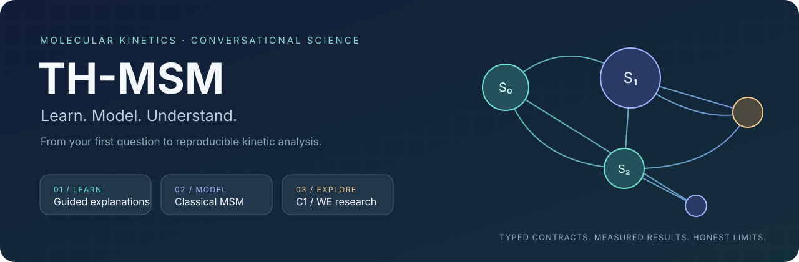
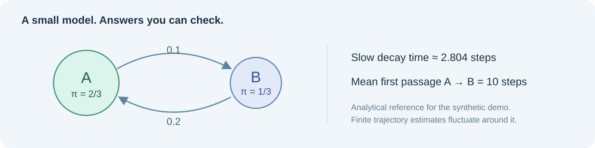

<div align="center">



**从第一句提问，到第一个可解释的动力学模型。**

[](https://github.com/masterTHou/TH-MSM-DSH/actions/workflows/ci.yml)
[](https://github.com/masterTHou/TH-MSM-DSH/releases)


[](LICENSE)

[开始使用](#开始使用) · [在对话里完成工作](#在对话里完成工作) · [经典 MSM](docs/CLASSICAL-MSM.md) · [科学约定](docs/SCIENCE.md) · [更新记录](CHANGELOG.md)

</div>

TH-MSM 是面向科研使用者和客户的 **DeepSeek Harness 对话式 MSM 助手**。你可以先学懂一个概念，用自己的轨迹建立基础经典 MSM，或进入非绝热 C1/WE 研究流程。

不必先记工具名或准备所有参数。说出目标，向导会补问必要信息、读取已有文件中的设置，并把数值结果解释成你关心的科学问题。熟悉方法的用户也可以直接指定数据与参数。

## 你想从哪里开始？

| 你的目标 | 在 DSH 中这样说 | 你会得到 |
|---|---|---|
| **先学懂 MSM** | “我是新手，用两状态例子解释 MSM。” | 分层解释、手算例子、小练习与学习路线 |
| **先体验完整流程** | “我没有数据，带我跑第一个模型。” | 合成轨迹、真实模型 JSON、验证结果和入门说明 |
| **建立自己的模型** | “数据在 data/classical.json，帮我建立 MSM。” | 转移矩阵、稳态布居、谱与 ITS、留出轨迹 CK |
| **理解已有结果** | “解释模型结果，并计算到状态 1 的 MFPT。” | 带单位的数值、验证限制与后续分析建议 |
| **研究光化学路径** | “先跑非绝热演示，再看产物首达概率。” | FC→FSSH+EDC→C1；实验性 Direct/WE/CI-WE 比较 |

## 在对话里完成工作

```text
你：我是新手，想用 MSM，但现在还没有轨迹。

助手：我们可以先跑一个能手算验证的两状态例子。
      你更想先了解概念，还是直接看模型结果？
      · 先解释 MSM 是什么
      · 直接运行演示
      · 我已经有自己的数据

你：直接运行，结果用简单的话解释。

助手：演示已保存。模型估计 A/B 的长期布居约为 66.13%/33.87%，
      接近解析参考 66.67%/33.33%；A→B 的平均首达时间约 9.82 步，
      参考为 10 步。留出 CK 与当前 ITS 诊断支持这个例子。
      接下来你可以问：“为什么不是各占一半？”或“怎样换成我的数据？”
```

这是按默认种子实际运行结果编写的对话示例。具体回复由 DSH 的对话模型组织。

向导每轮集中问 **1–3 个相关问题**，提供推荐选项和示例回答；已提供或能从文件读出的信息不重复问。会话内记住目标、文件与学习水平，切换目标时清理不相关数据。专家可直接传参数跳过向导。

## 开始使用

### 在 DSH 中安装

1. 从 [GitHub Releases](https://github.com/masterTHou/TH-MSM-DSH/releases) 下载最新 `th-msm-dsh-plugin-x.y.z.tgz`。
2. 在 DeepSeek Harness 插件管理面板安装。
3. 在问答窗口说：“带我跑第一个 MSM。”

发布包包含编译后的 JS、类型声明、知识库与 `ml-matrix` 数值依赖；运行内置经典 MSM 和解析非绝热演示无需 Python、量化软件或 Jev API Key。DSH 主机仍需提供 package.json 声明的三个 peer dependencies。

**安装后提示 `failed to import`？** 请安装 v1.4.1 或更新的 `.tgz`，然后在保存工作后完全退出并重新打开 DSH，以清除旧模块缓存。v1.4.1 补齐了插件入口的默认导出解析条件，并增加真实发布包的导入检查。如果仍有错误，请提供 DSH 的版本和该提示之前的原始异常；`failed to import` 是主机汇总信息，本身不包含具体原因。

### 从源码体验

需要 Node.js ≥22。

```sh
git clone https://github.com/masterTHou/TH-MSM-DSH.git
cd TH-MSM-DSH
npm ci --ignore-scripts
npm run demo:msm
```

打开 `output/msm-demo/START-HERE.md`，查看数据、模型和参考答案。非绝热演示使用 `npm run demo`。

## 一个能自己核对的模型



默认演示用已知转移矩阵生成 **12 条独立合成轨迹**，其中 3 条完整轨迹留作验证。它不是分子模拟，适合学习并检查程序输出是否符合解析答案。

| 结果 | 解析参考 | 默认演示估计 |
|---|---:|---:|
| 状态 A 的稳态布居 | 66.67% | 66.13% |
| 状态 B 的稳态布居 | 33.33% | 33.87% |
| A→B 平均首达时间 | 10 步 | 9.82 步 |

有限样本会有波动。点估计的小数位不能代替置信区间；当前经典 π/MFPT 区间尚未实现。

## 换成自己的数据

支持 **离散状态序列**或**预提取数值特征**的 JSON。每条轨迹保留独立边界，并声明帧间隔和单位。

```json
{
  "kind": "classical-trajectories",
  "origin": "unbiased-md",
  "frame_time": 0.1,
  "time_unit": "ps",
  "trajectories": [[0, 0, 1, 1, 0], [1, 1, 0, 0, 1]]
}
```

上面只是格式示例，采样量不足以建立科研结论。完整说明与特征模板见 [经典 MSM 指南](docs/CLASSICAL-MSM.md)。XTC/DCD 等原始轨迹需要先提取特征；你可以在对话里先询问特征选择。

熟悉工具的用户可直接调用：

```js
th_msm_build({trajectoryPath:'data/classical.json', lagTime:2})
th_msm_analyze({modelPath:'output/msm/model.json', targetState:1})
th_msm_report({title:'我的动力学分析', modelPath:'output/msm/model.json'})
```

开发者也可独立使用科学 API：

```ts
import { buildClassicalModel, mfptToState } from '@th-msm/dsh-plugin/msm'
const model = buildClassicalModel(dataset, { lagFrames: 2 })
const passage = mfptToState(model, 1)
```

## 经典动力学与非绝热光化学，各有明确入口

| | 经典 MSM | 非绝热 C1 / WE |
|---|---|---|
| 输入 | 无偏经典离散轨迹 / 预提取特征 | FC 完整动力学状态与加权事件历史 |
| 核心结果 | P、π、衰减时间尺度、MFPT | 有限时域首达曲线、带方向的跃迁通量 |
| 验证 | 连通性、ITS、独立留出 CK | 权重与吸收质量、能漂、电子范数、独立 runs |
| 使用边界 | 需要在所选 lag 下检验马尔可夫假设 | C1 不要求马尔可夫假设，依赖底层传播器 |

非绝热分支保留完整 R/P/c/活性态克隆、PRNG 状态、三个 CI 集合与 ES 成本账本。**π 不解释为光解分支比**，静态 CI 不作为无动量轨迹源。

已执行的 10,000 条双 CI 扩展模型参考轨迹给出稀有通道首达概率 **2.24%**（95% Wilson 区间 **1.97%–2.55%**）。同批比较未观测到 CI-WE 效率优势，结果完整保留。见 [实验记录](benchmarks/README.md)。

## 当前能力范围

| 能力 | 状态 |
|---|---|
| 对话向导、12 个主题、三个教学层次 | 可用 |
| 基础非可逆 MSM、KMeans、π、谱、MFPT | 可用；2–128 个状态 |
| 多 lag ITS、留出 CK、真实 Markdown 报告 | 可用；启发式阈值与局限公开 |
| C1 首达/跃迁统计、独立 run Bootstrap | 可用 |
| 标准 LVC、扩展双 CI、FSSH+EDC、WE | 实验功能 |
| XTC/DCD 直接读取、tICA/VAMP 数值后端 | 尚未实现；支持概念教学 |
| 可逆 MLE、PCCA+、经典 TPT、π/MFPT 区间 | 尚未实现 |
| 非绝热吸收 C2、外部 ES 传播、严格预算调度 | 尚未实现 |

验证不足会明确显示 `INSUFFICIENT_DATA`，不把“程序运行成功”当作“模型科学可信”。解析模型的 sink 是声明的首达边界，不证明真实分子解离。

## TypeScript 与 Jev 的取舍

新的 MSM、教学、向导与决策核心及轨迹类型使用严格 TypeScript；已有 JS 模块渐进迁移，统一编译为 JS 发布。类型约束能改善维护与接口检查，物理和统计正确性仍靠运行时校验与独立测试。

借鉴 Jev 的 **共享状态 → 有限选项 → 类型明确的决策** 思路，让软件工作流更清楚。当前使用本地可复现规则，冲突时补问，用户明确选择优先。**未接入在线 Jev，也不把规则分数伪装成校准概率。** 决策层不能修改分子跃迁概率、WE 权重或科学数值。详见 [设计说明与官方来源](docs/TYPESCRIPT-AND-DECISIONS.md)。

## 给开发者

```text
src/msm/          TypeScript：估计、谱、MFPT、特征与示例
src/education/    TypeScript：分层课程、练习和学习路线
src/decision/     TypeScript：结构化路由与对话状态
src/types/        TypeScript：科学数据契约
src/core/         轨迹校验与成本账本
src/dynamics/     FC、FSSH+EDC、可取消的 worker
src/analysis/     C1 首达与跃迁通量
src/sampling/     PRNG、WE 分裂与合并
src/tools/        DSH 工具适配
lib/              编译产物与 .d.ts（发布入口）
```

```sh
npm run typecheck
npm test
npm run check
npm pack --pack-destination dist
```

CI 覆盖 Linux/Windows 与 Node 22/24。测试包含解析模型、负向 CK、数据泄漏检查、类型契约、对话记忆与真实 DSH 工具输出 schema。实际 DSH 桌面对话效果仍欢迎试用反馈。

<div align="center">

[报告问题与建议](https://github.com/masterTHou/TH-MSM-DSH/issues) · [科学方法](docs/SCIENCE.md) · [经典建模指南](docs/CLASSICAL-MSM.md) · [MIT License](LICENSE)

</div>
