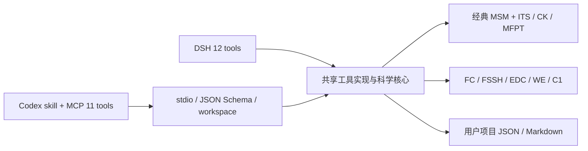

# Trajectory Hub for Markov State Modeling (TH-MSM) for Codex

**第一次使用请先看 [完整软件使用手册](USER-MANUAL.md)**：包含可复制提示词、第一次运行、自己的数据、工具参数和排错；本页侧重 Codex 宿主配置。

## 安装

需要 Codex 支持本地插件与 MCP，并且其进程可在 PATH 找到 Node.js ≥22。运行 `node --version` 检查。

```sh
codex plugin marketplace add masterTHou/Trajectory-Hub-for-Markov-State-Modeling-TH-MSM --ref v1.5.2
codex plugin add th-msm@th-msm-plugins
```

重开 Codex 或新建对话并选择 TH-MSM。如果插件已安装但当前对话还没有工具，重新打开新对话；不要重复添加不同身份的插件。

安装命令使用 Codex 官方 marketplace 流程，布局同时提供 Agent Plugins 1.0 清单和 `.codex-plugin` 兼容清单。规范参考：[Package your plugin](https://developers.openai.com/plugins/build/plugins)。本项目在 GitHub 分发，尚未提交 OpenAI 公共目录。

### 本地仓库或团队分发

从 Release 下载源代码 ZIP，解压到长期保留的目录：

```sh
codex plugin marketplace add "/absolute/path/to/Trajectory-Hub-for-Markov-State-Modeling-TH-MSM"
codex plugin add th-msm@th-msm-plugins
```

无需编译。仓库的 `plugins/th-msm/server/` 已包含独立 JS 运行包与第三方许可。

独立的 `th-msm-codex-plugin-1.5.2.tar.gz` 解压后根目录就是一个插件。已有 marketplace 的团队可将其放到自己的 `plugins/th-msm` 目录，并登记相对路径 `./plugins/th-msm`。不要将 DSH `.tgz` 当成 Codex 安装包。

## 第一句话

- “我是新手，用能手算的两状态例子解释 MSM。”
- “我的项目目录是 D:/research/project，没有数据，带我跑第一个模型。”
- “用 data/classical.json 建模，再解释 MFPT 和 CK。”
- “先运行一个小规模解析非绝热演示，然后查看首达概率。”

向导每次补问 1–3 个必要问题。已知道参数时可以直接执行。实际语言组织由宿主对话模型负责。

## 工具

工具发现可能加 MCP 命名空间前缀，下面是基础名称。

| 工具 | 用途 |
|---|---|
| th_msm_env | 查看 Node/系统与解析引擎状态 |
| th_msm_guide | 选择目标、补问数据与参数 |
| th_msm_example | 生成经典两状态数据、模型与入门说明 |
| th_msm_build | 从轨迹建立经典 MSM 或非绝热 C1 |
| th_msm_analyze | 分析布居、时间尺度、MFPT 或首达概率 |
| th_msm_validate | ITS/CK 或非绝热物理诊断 |
| th_msm_report | 保存真实结果的 Markdown 报告 |
| th_msm_teach | 分层概念讲解与练习 |
| th_msm_knowledge | 内置文献的离线关键词检索 |
| th_msm_plan | 提供方案建议，未实现的算法仍需外部工具 |
| th_msm_sample | FC 出发的解析 FSSH+EDC / WE 演示 |

不提供 DSH 的外部 shell 注册命令代理；`build mode=index` 与向量模型下载在 Codex 版禁用。无需量化软件、Jev Key 或额外 AI API Key，宿主本身的使用条件仍由 Codex 决定。

## 工作区与会话

文件工具必须传入绝对 `workspaceRoot`，相对输入/输出均在此目录内。程序检查路径越界和已有符号链接，并按工作区顺序执行调用，避免插件自己并发覆盖结果。读写仍受操作系统进程权限影响；这是应用层边界，不是 OS 沙箱。结果文件可能覆盖同名输出，使用不同 outputPath/outputDir 可以保留多次分析。

服务不把安装目录当用户工作区。可在 MCP 环境中设置 `TH_MSM_WORKSPACE`，将该服务固定到一个项目根目录；未设置时由每次调用指定用户选择的项目。

向导用 `conversationId` 与规范化的工作区共同隔离记忆。每个对话使用不同 ID；省略 ID 时不跨调用记忆，助手可以从对话内容补齐参数。程序不自动上传轨迹，也不向 Jev 或量化软件发出调用。

## 架构与维护



`src/codex/server.js` 只适配 MCP 调用、工作区、取消与会话，不复制科学算法。编译时仅替换 DSH 的 `defineTool` schema 适配器；DSH 使用原有主机适配器。Codex bundle 中禁止出现 DSH runtime 依赖。MCP SDK、Ajv、ml-matrix 与需要的第三方代码一起打包，许可见插件中的 `THIRD-PARTY-NOTICES.md`。

开发命令：

```sh
npm ci --ignore-scripts
npm test
npm run pack:codex
node scripts/smoke-codex-package.mjs dist/th-msm-codex-plugin-1.5.2.tar.gz
```

不要手工修改生成的 `plugins/th-msm/server/`，编辑源代码后重新构建。发布前需要提交生成产物，使 GitHub marketplace 安装无需开发工具链。

## 科学边界与验证范围

科学约束及未实现功能沿用 [SCIENCE.md](SCIENCE.md)。两宿主共享同一模型格式；测试直接比较默认示例的转移矩阵与稳态布居，并通过 MCP 运行建模、验证、报告和独立 worker 的 C1 闭环。

v1.5.2 在 Windows 的 Codex CLI 隔离配置中验证了 marketplace 安装，并对安装缓存中的真实 MCP 服务完成工具发现与调用。Codex app-server 也成功识别已启用的插件与 skill，并启动 MCP 服务、发现全部 11 个工具。当前运行中的用户 GUI 对话不会自动获得新工具，完整桌面对话体验仍需安装后新开对话验证。Linux/Windows Node 22/24 的 CI 同时测试 DSH 与独立 Codex 发布包。
