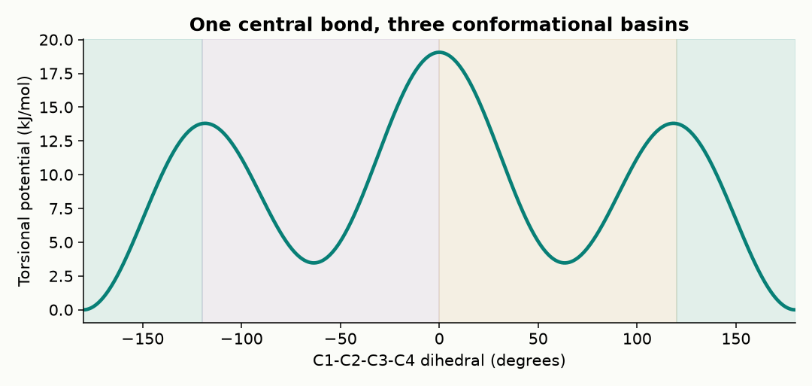
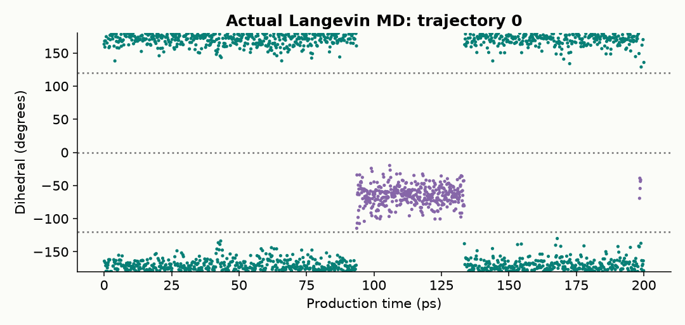
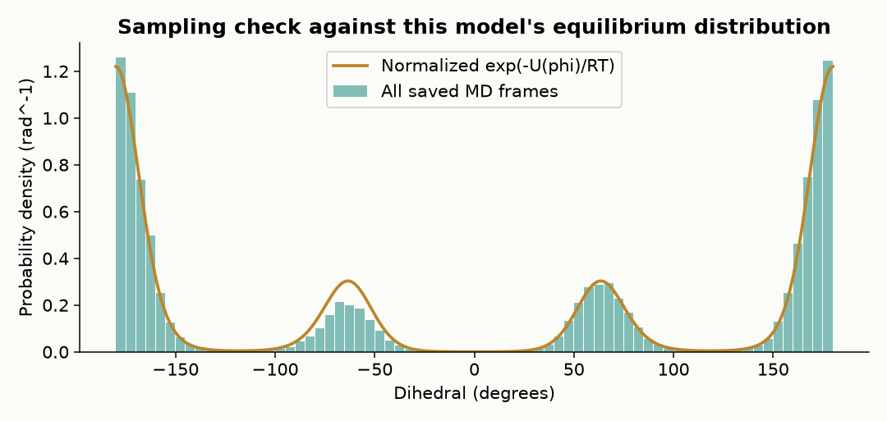
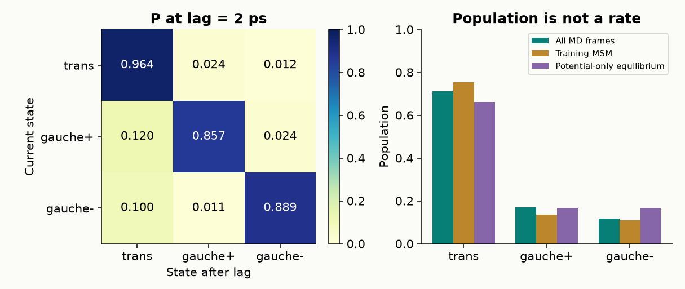
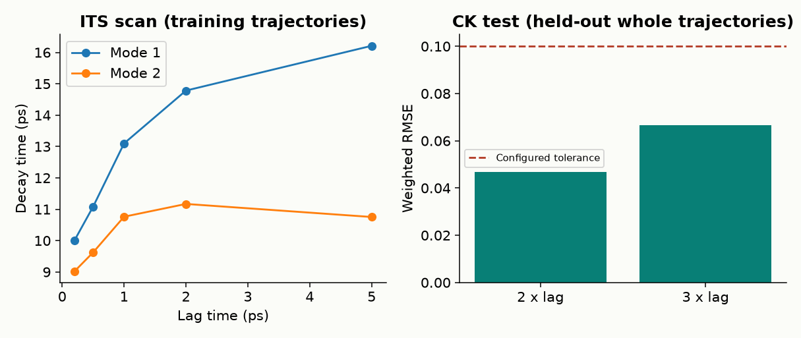
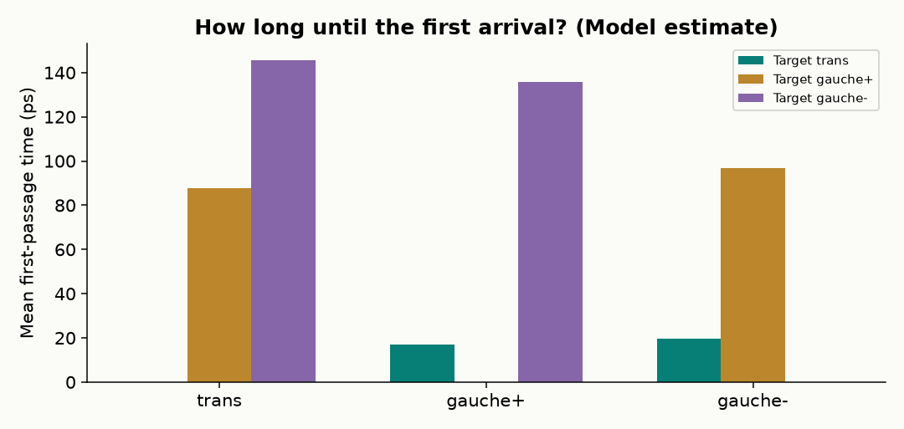

# 正丁烷全流程实际运行结果

模型：四站点联合原子孤立正丁烷，OPLS-style 局部参数。温度 300 K，摩擦系数 5 ps⁻¹。

12 条独立轨迹，每条先平衡 20 ps，再生产 200 ps；保存间隔 0.1 ps，MSM lag 2 ps。

训练 / 留出轨迹：9 / 3。验证结论：**SUPPORTED_AT_TESTED_LAGS**。

| 构象 | 训练 MSM 长期布居 | 全部 MD 帧占比 | 同一扭转势的 Boltzmann 积分 |
|---|---:|---:|---:|
| trans | 0.7539 | 0.7107 | 0.6627 |
| gauche+ | 0.1353 | 0.1710 | 0.1686 |
| gauche- | 0.1108 | 0.1183 | 0.1686 |

三个数来自不同估计，有限采样下不必完全一致。理论积分针对本模型，不是实验参考真值。

MD 耗时 49.16 s；Python 峰值工作集 130.48046875 MiB；单线程 CPU 平台。峰值不包含 Node 子进程与系统文件缓存。电子结构调用 0；没有可声明的量化计算加速比。

恒温 MD 的总能量会与热浴交换，不能要求它逐步守恒。额外 2 ps NVE 检查的原始结果见 manifest.json，两个步长各一条短段只作数值诊断，不能证明长轨迹收敛。

## 图像

## 边界

- Local OPLS-style bonded subset; no solvent or explicit hydrogens
- Thermostat friction and coarse representation affect kinetics; not experimental butane rates
- MSM projection must be tested; passing is not proof of Markovianity
- No confidence intervals on stationary populations or MFPT
- Seeds do not guarantee bitwise reproducibility across OpenMM platforms/versions
